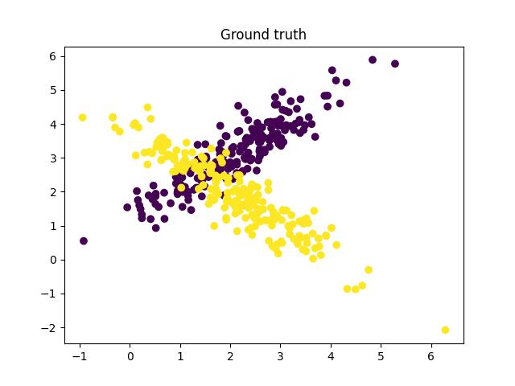
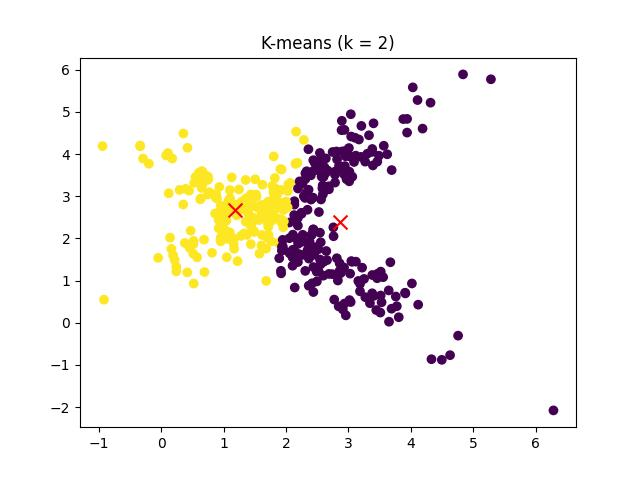
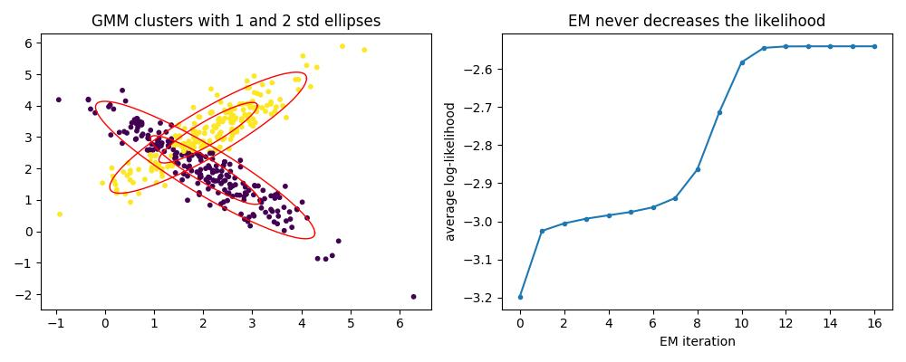
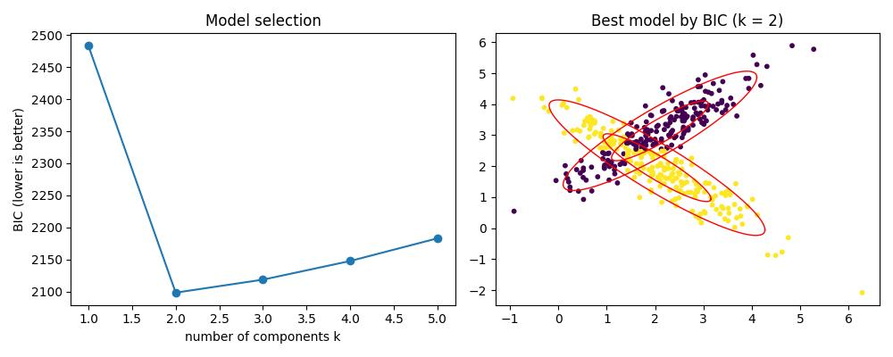

# Gaussian Mixture Models

Code (from scratch, in numpy/scipy) for Gaussian mixture models fitted with the Expectation-Maximization (EM) algorithm.

---

## Theory

Please note that the theory corresponding to the codes is hosted on this [page](https://parag1604.github.io/notes/Machine-Learning/Clustering-and-Expectation-Maximization)

## Python Environment Setup

Use python >= 3.10 and install the requirements (numpy, scipy and matplotlib):

```bash
pip install -r requirements.txt
```

## Data

No dataset is needed. `utils.py` samples 400 points from two crossing 2-D Gaussians: both are centred near (2, 2.5), one is stretched along y = x and the other along y = -x.

## Running

The EM algorithm lives in `GaussianMM.py`. Each script below adds one new idea.

### 0. The data, and why K-means fails

```bash
python version0.py
```

K-means separates clusters with straight lines and ignores their shape, so on this data it is barely better than chance (about 53% with the default seed). Saves `data_vis.jpg` and `kmeans_vis.jpg`:

Ground truth             |  K-means
:-------------------------:|:-------------------------:
  |  

### 1. EM for a Gaussian mixture

```bash
python version1.py
```

Each component has its own mean, full covariance and mixing weight. The E-step computes soft assignments (responsibilities), and the M-step re-estimates the parameters as responsibility-weighted averages. The log-likelihood never decreases. With the default seed, EM recovers the two elongated clusters (about 90% of points labelled correctly; the points in the overlap at the centre are genuinely ambiguous). Saves `pred_vis.jpg`:



EM only finds a local optimum, so try a few `--seed` values.

### 2. Stable EM, restarts and choosing k with BIC

```bash
python version2.py
```

The E-step is rewritten with log densities and log-sum-exp, which avoids underflow. Each `k` is fitted from several seeds, keeping the best likelihood. The likelihood keeps rising with `k`, so the Bayesian information criterion (BIC), which penalizes the number of parameters, picks the model; here it picks `k = 2`. Saves `bic_vis.jpg`:


